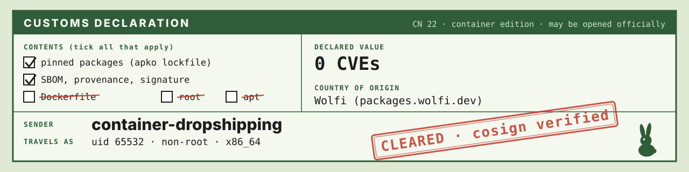

<p align="center">
  
</p>

# container-dropshipping

Upstream tools, dropshipped: repackaged into minimal, non-root Wolfi images
with [melange](https://github.com/chainguard-dev/melange) and
[apko](https://github.com/chainguard-dev/apko). No Dockerfiles, signed with
keyless cosign, published to GHCR.

## Components

| Component | Image | What | Shell? |
|-----------|-------|------|--------|
| [`tofu-ci`](components/tofu-ci/README.md) | `ghcr.io/backend-bunny/tofu-ci` | OpenTofu 1.13.1 + age/curl/jq/git/ssh for GitLab CI jobs | yes (toolbox exception) |
| [`signal-cli`](components/signal-cli/README.md) | `ghcr.io/backend-bunny/signal-cli` | Signal messenger CLI / JSON-RPC daemon | no (distroless) |
| [`haproxy`](components/haproxy/README.md) | `ghcr.io/backend-bunny/haproxy` | HAProxy 3.4 LTS load balancer (Wolfi package, no melange) | no (distroless) |

Every image runs as uid/gid **65532** and is built for `x86_64` only.

Tags: the upstream version (`1.13.1`), `<version>-<YYYYMMDD>` and
`sha-<commit>`. **Pin by digest.**

## Verify an image

Every published digest is signed keylessly by this repo's `publish` workflow
and carries an SPDX SBOM and SLSA build provenance:

```sh
IMAGE=ghcr.io/backend-bunny/tofu-ci@sha256:...

cosign verify "$IMAGE" \
  --certificate-identity-regexp '^https://github.com/backend-bunny/container-dropshipping/' \
  --certificate-oidc-issuer https://token.actions.githubusercontent.com

cosign verify-attestation "$IMAGE" --type spdxjson \
  --certificate-identity-regexp '^https://github.com/backend-bunny/container-dropshipping/' \
  --certificate-oidc-issuer https://token.actions.githubusercontent.com

gh attestation verify "oci://$IMAGE" --owner backend-bunny
```

## How it builds

```
components/<name>/melange.yaml ──melange──▶ APKs signed with a throwaway key
                                                   │
components/<name>/apko.yaml ─┐                     ▼
components/<name>/apko.lock.json ──apko build --lockfile──▶ image + SBOM
                                                   │
                     (main only) apko publish ─▶ cosign sign + attest
```

- **Ephemeral melange keys:** each build runs `melange keygen`, signs the APKs,
  deletes the private key, and gives apko the public half. No key is stored
  anywhere. Image trust comes from cosign.
- **Workflows:** `ci` (PRs: build + test + lock check for changed components,
  `contents: read` only), `publish` (push to `main`: build, test, push, sign,
  attest), `lock-refresh` (weekly: open a PR with new lockfiles).
- Components are discovered from `components/*/apko.yaml`: adding a
  component means adding a directory.

## Lockfiles and refreshes

Each component commits `apko.lock.json`, and every build uses it, so a given
commit installs exactly the reviewed Wolfi package versions and checksums.

- The lock covers **Wolfi packages only**. Packages built here by melange are
  rebuilt every time (and their hash changes with every commit), so at build
  time they are merged in fresh. See
  [the wiki](.agents/wiki/troubleshooting/apko-lockfile-local-packages.md).
- CI fails if `apko.yaml` changed without a relock, or if the packages it
  resolves no longer match the lock. Fix: `task lock -- <name>` in the same PR.
- `lock-refresh` runs every Monday (and on demand). It re-locks every
  component and opens or updates **one** PR, `chore/lock-refresh`, listing the
  package bumps. It then dispatches `ci` on that branch (PRs pushed with
  `GITHUB_TOKEN` don't trigger CI on their own), so it's tested like any PR;
  **merging it publishes** the updated images. The PR requests review from
  the maintainer, who gets an email with the bump list and merges it by hand. Renovate doesn't manage apko
  lockfiles yet. We're waiting on
  [renovatebot/renovate#38142](https://github.com/renovatebot/renovate/pull/38142). Images only pick up Wolfi security fixes when these PRs are
  merged.

## Dependency updates

[Renovate](https://docs.renovatebot.com/) (Mend GitHub App) handles:

- upstream versions via `# renovate:` comments in `melange.yaml`
  (OpenTofu minor/major bumps need Dependency Dashboard approval),
- the toolchain in `devbox.json`/`devbox.lock`,
- GitHub Actions, pinned by commit SHA.

## Local development

Tools (melange, apko, cosign, task, bubblewrap, ...) are pinned in
`devbox.json`/`devbox.lock`, the same set CI installs. With
[direnv](https://direnv.net/), `direnv allow` once and the committed
`.envrc` loads the devbox environment on `cd`; otherwise run `devbox shell`.

```sh
devbox shell                     # or: direnv allow
task build -- tofu-ci            # melange build + test, apko build from lock
task test -- tofu-ci             # + smoke test in Docker
task publish-dry-run -- tofu-ci  # + print the tags CI would push
task lock -- tofu-ci             # regenerate the lockfile
task lock:all
```

Downloads (Gradle/Go dependencies, Wolfi build-environment APKs) are cached
in `.cache/` (gitignored) and reused across builds; CI persists the same
directory per component.

melange needs unprivileged user namespaces (bubblewrap). On Ubuntu 24.04:
`sudo sysctl -w kernel.apparmor_restrict_unprivileged_userns=0`.

Operational notes and decisions live in [`.agents/wiki/`](.agents/wiki/index.md).
